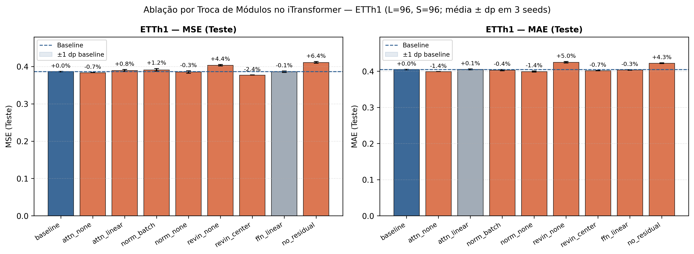
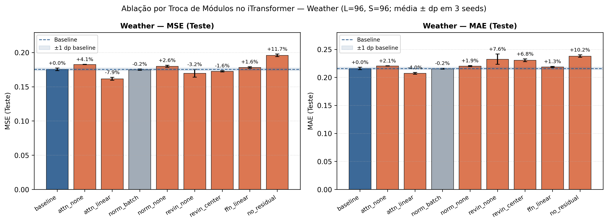

# Roteiro de Apresentação — Trabalho Final de Aprendizado de Máquina Profundo (UFSM)

**Grupo:** André Renner, Andrei Hammacher, Rafael Wagner  
**Artigo:** *iTransformer: Inverted Transformers Are Effective for Time Series Forecasting* (Liu et al., ICLR 2024)  
**Duração-alvo:** 10–12 minutos (11 slides, ~1 min/slide)  
**Estrutura:** Espelha integralmente o relatório `relatorio/main.tex`

---

## Slide 1 — Capa (0:30)
- **Título:** Análise Experimental por Troca de Módulos no iTransformer
- **Subtítulo:** Onde e como operam os módulos de Deep Learning na previsão de séries temporais multivariadas
- **Metadados:** André Renner, Andrei Hammacher, Rafael Wagner | UFSM — Aprendizado de Máquina Profundo | Prof. Thiago L. T. da Silveira | Dezembro/2026
- **Fala-chave:** Apresentar rapidamente o objetivo do trabalho: abrir a caixa-preta do iTransformer trocando sistematicamente cada módulo avançado para verificar seu papel real e seu custo computacional.

---

## Slide 2 — Motivação e Ideia Central do iTransformer (1:00)
- **Problema do Transformer padrão em séries temporais:**
  - Token = instante temporal $t$ (agrupa todas as $N$ variáveis num único vetor).
  - Mistura variáveis com escalas/unidades diferentes e limita o campo receptivo temporal.
- **Solução do iTransformer (ICLR 2024):**
  - Mantém o codificador Transformer intacto, mas **inverte** os eixos: cada **variável inteira** ($L$ passos) vira um token ($B \times L \times N \to B \times N_{\text{tok}} \times E$).
  - Atenção aprende **correlações entre variáveis**; FFN aprende **representação temporal** de cada série.
- **Visual sugerido:** Comparação lado a lado: *Token temporal* vs. *Token de variável (invertido)*.

---

## Slide 3 — Mapeamento dos Módulos e Fluxo de Tensores (1:15)
- **Visual principal:** Diagrama do relatório ($B \times L \times N \to B \times N_{\text{tok}} \times E \to B \times N \times S \to B \times S \times N$).
- **Fórmulas-chave na tela (enxutas):**
  1. **Normalização de instância (RevIN):** $\tilde{X}_{:,n} = (X_{:,n}-\mu_n)/\sigma_n$ + desnormalização na saída.
  2. **Embedding invertido:** $h_n^{(0)} = W_e \tilde{X}_{:,n} + b_e$ (inclui 4 covariáveis temporais como tokens extras: $N_{\text{tok}} = N + 4$).
  3. **Self-Attention entre variáveis:** $\text{softmax}(QK^\top/\sqrt{d_k})V$ com mapa $N_{\text{tok}} \times N_{\text{tok}}$.
  4. **LayerNorm por token** + **FFN ($1\times 1$ Conv + GELU)** + **Conexões residuais** + **Projeção linear** $\hat{y}_n = W_p h_n$.
- **Fala-chave:** Destacar *qual representação* cada módulo enxerga (série inteira vs. vetor de features vs. lote).

---

## Slide 4 — Desenho Experimental e Controle de Qualidade (1:00)
- **Reprodutibilidade:** código oficial `thuml/iTransformer` fixado no commit `c2426e6`, preservando a ordem exata de inicialização dos parâmetros no `AblationEncoderLayer`.
  - **Teste de equivalência:** saída do modelo modificado em modo `baseline` é bit-a-bit idêntica à do original (`max_diff = 0.0` em `eval()` e `train()`).
- **Recorte experimental (justificado por tempo/GPU):**
  - Lookback $L = 96$, horizonte único $S = 96$.
  - 2 bases: **ETTh1** ($N=7$, $N_{\text{tok}}=11$, $E=256$, 2 camadas) e **Weather** ($N=21$, $N_{\text{tok}}=25$, $E=512$, 3 camadas).
  - **3 seeds** (2021, 2022, 2023) $\times$ **9 variantes** $\times$ **2 bases** = **54 treinos** executados em GPU **Tesla T4** (~2h15 total).
- **Métricas:** MSE, MAE (média $\pm$ desvio), $\Delta\%$ vs. baseline, detecção de ruído ($|\Delta| < \sigma_{\text{base}}$), nº de parâmetros, tempo/época e épocas até *early stopping*.

---

## Slide 5 — As 9 Configurações (Mapa das Trocas de Módulos) (1:00)
- **Tabela visual resumida por família:**
  - **Baseline:** iTransformer original.
  - **Atenção entre variáveis:** `attn_none` (remove atenção) e `attn_linear` ($W_o \cdot M \cdot (X W_v)$, mistura estática independente da entrada).
  - **Normalização da representação:** `norm_batch` (BatchNorm1d em $B \cdot N_{\text{tok}}$ tokens) e `norm_none` (Identity) — em `norm1`, `norm2` e `norm_out`.
  - **Normalização de instância:** `revin_none` (desliga) e `revin_center` (só remove/soma média, sem desvio).
  - **FFN:** `ffn_linear` (substitui MLP+GELU por `nn.Linear(E, E)`).
  - **Resíduos:** `no_residual` (remove ambos os atalhos residuais do encoder layer).
- **Fala-chave:** Explicar rapidamente a hipótese que cada troca testa.

---

## Slide 6 — Reprodução do Baseline vs. Artigo Original (0:45)
- **Tabela de conferência ($L=96, S=96$, valores verificados em `arXiv:2310.06625`):**

| Base | Artigo MSE | Nosso Baseline MSE | Dif. MSE | Artigo MAE | Nosso Baseline MAE | Dif. MAE |
|---|---:|---:|---:|---:|---:|---:|
| **ETTh1** | 0,386 | **0,3864 ± 0,0008** | +0,10% | 0,405 | **0,4046 ± 0,0008** | -0,10% |
| **Weather** | 0,174 | **0,1753 ± 0,0019** | +0,76% | 0,214 | **0,2159 ± 0,0021** | +0,91% |

- **Fala-chave:** Reprodução praticamente idêntica (<1% de diferença), com pequenas variações explicadas pela média em 3 seeds (vs. seed única 2023 no repo original), PyTorch 2.14+cu130 e não determinismo de GPU.

---

## Slide 7 — Visão Geral dos Resultados (Gráficos de Barras) (1:00)
- **Visual principal (inserir os dois PNGs 300 dpi):**

- **Destaque visual:** Barras cinzas marcam diferenças menores que o desvio-padrão do baseline (dentro da faixa de ruído: `attn_linear` MAE e `ffn_linear` MSE em ETTh1; `norm_batch` MSE/MAE em Weather).
- **Fala-chave:** Dar o panorama imediato: `no_residual` degrada fortemente ambas as bases; `attn_linear` surpreende em Weather (`-7,9%` MSE).

---

## Slide 8 — Análise: Atenção entre Variáveis (`attn_none` vs. `attn_linear`) (1:15)
- **Pergunta científica:** Misturar variáveis importa? E precisa ser *dependente da entrada* (softmax) ou uma matriz estática $M \in \mathbb{R}^{N_{\text{tok}} \times N_{\text{tok}}}$ basta?
- **Evidência nos dados (confirma a hipótese de dependência de $N$):**
  - **ETTh1 ($N=7$):** `attn_none` **melhorou levemente** (`-0,69%` MSE → `0,3838`; `-1,35%` MAE → `0,3991`) com **62,5% menos parâmetros** (`315k` vs. `842k`) e `2,5` vs. `3,7` s/ép. `attn_linear` ficou próximo (`+0,76%` MSE; MAE no ruído).
  - **Weather ($N=21$):** `attn_none` **piorou claramente** (`+4,10%` MSE → `0,1825`; `+2,09%` MAE → `0,2205`, indo a `10,0` épocas) — misturar canais importa muito mais com 21 variáveis!
  - **Achado-chave em Weather:** `attn_linear` alcançou o **melhor resultado geral da base** (`0,1615 ± 0,0022`, **`-7,87%` MSE**; `0,2073 ± 0,0016`, **`-4,03%` MAE**) com **32,6% menos parâmetros** (`3,26M` vs. `4,83M`) e **24% mais rápido** (`15,6` vs. `20,5` s/ép).
- **Interpretação:** Relações físicas entre variáveis meteorológicas são majoritariamente estacionárias; a matriz fixa $M$ reduz variância/sobreajuste frente à atenção softmax.

---

## Slide 9 — Análise: Normalizações (Instância vs. Representação) (1:15)
- **Normalização de instância (`revin_none`, `revin_center`):**
  - **ETTh1:** `revin_none` foi a **2ª pior variante** (`+4,44%` MSE → `0,4036`; `+4,95%` MAE → `0,4247`), confirmando forte não estacionariedade de nível. Porém `revin_center` teve o **melhor MSE no ETTh1** (`0,3772`, `-2,37%`), sugerindo que dividir pelo desvio em janelas curtas ($L=96$) amplifica ruído.
  - **Weather:** efeito assimétrico — `revin_none` e `revin_center` baixaram o MSE (`-3,23%` e `-1,59%`), mas **pioraram fortemente o MAE** (`+7,64%` → `0,2325` e `+6,77%` → `0,2306`), além de `revin_none` triplicar o desvio entre seeds (`±0,0057`). A escala pelo desvio protege variáveis de menor amplitude e estabiliza o treino.
- **Normalização da representação (`norm_batch`, `norm_none`):**
  - **ETTh1 ($L_{\text{enc}}=2$):** `norm_batch` degradou MSE (`+1,19%`, `±0,0037`) e foi a mais lenta (`4,0` s/ép), consistente com misturar séries heterogêneas no lote; `norm_none` obteve o menor MAE (`0,3989`, `-1,41%`).
  - **Weather ($L_{\text{enc}}=3$):** `norm_batch` empatou no **ruído** com o baseline (`-0,24%` MSE, `-0,25%` MAE), mas exigiu mais épocas (`9,0` vs. `6,0`) e mais tempo (`21,4` s/ép); já `norm_none` piorou (`+2,58%` MSE, `+1,94%` MAE), mostrando que a normalização interna importa mais com maior profundidade.

---

## Slide 10 — Análise: FFN, Conexões Residuais e Custo Computacional (1:00)
- **FFN (`ffn_linear`):**
  - **ETTh1:** dentro do ruído em MSE (`0,3861`, `-0,09%`), `-0,26%` em MAE, economizando 15,6% de parâmetros (`710k` vs. `842k`).
  - **Weather:** degradação moderada acima do ruído (`+1,61%` MSE → `0,1782`; `+1,25%` MAE → `0,2186`) — a não linearidade do GELU ajuda mais em dinâmicas complexas.
- **Conexões residuais (`no_residual`):**
  - **Maior degradação em ambas as bases:** ETTh1 **`+6,38%` MSE** (`0,4110`) / `+4,33%` MAE; Weather **`+11,69%` MSE** (`0,1958`) / **`+10,25%` MAE** (`0,2381`), atingindo o limite de 10 épocas (vs. 6,0 no baseline). A penalidade quase dobra ao passar de 2 para 3 camadas.
- **Resumo de custo (Tesla T4):**
  - Atenção = **62,5% (ETTh1)** a **65,2% (Weather)** dos parâmetros (`attn_none`: `2,5s` e `12,0s/ép`).
  - `attn_linear` economiza **~33% de parâmetros** e **~24% de tempo/época** em Weather, sendo o melhor trade-off custo-precisão.
  - `norm_batch` tem o maior tempo/época (`4,0s` em ETTh1; `21,4s` em Weather).

---

## Slide 11 — Limitações, Conclusões e Lições Aprendidas (1:00)
- **Limitações honestas:**
  - Horizonte único ($S=96$), 2 bases ($N=7$ e $21$), 3 seeds — autoatenção dinâmica pode ganhar relevância em horizontes longos ($S=720$) ou bases massivas (ex.: Traffic, $N=862$).
- **Ranking empírico de impacto dos módulos:**
  1. **Conexões residuais** — críticas em ambas as bases (`+6,4%` a `+11,7%` MSE sem elas).
  2. **Normalização de instância** — essencial para nível/estabilidade e MAE (`+5,0%` a `+7,6%` MAE sem ela).
  3. **Mistura entre variáveis** — irrelevante em ETTh1 ($N=7$), decisiva em Weather ($N=21$), onde mistura estática (`attn_linear`) superou a atenção softmax (`-7,9%` MSE).
  4. **Normalização interna e FFN não linear** — impacto pequeno em 2 camadas (ETTh1), moderado em 3 camadas (Weather).
- **Encerramento:** A inversão de tokens do iTransformer reposiciona *o que* cada módulo de Deep Learning faz — e a ablação controlada permite separar intuição arquitetural de evidência empírica. Obrigado e perguntas!
